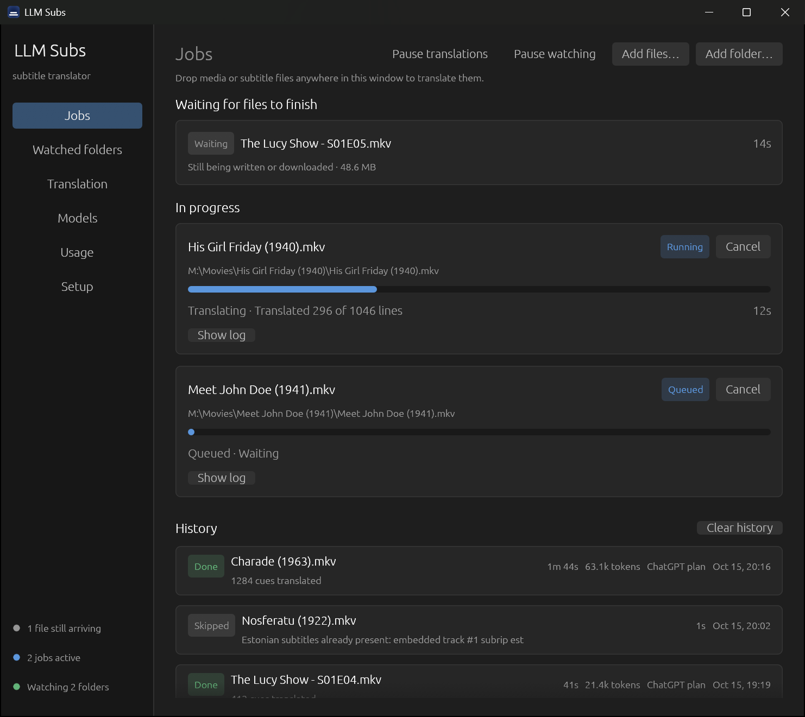

# LLM Subs

A robust and simple subtitle translator app that is feature-rich enough to be useful.
Easy setup, and it can connect to your ChatGPT account for cheap and quick translations.



- Point it at the folders your films and shows land in; new files are translated as they arrive.
- Dialogue goes to the model in batches, each with the lines just before it, so the model
  knows who is talking to whom and the result reads like a proper translation.
- Batches run in parallel and several files can be translated at once, so it's quick.
- Only the text goes to the model: timestamps, numbering and formatting codes are stripped
  and repeated lines are sent once, which keeps token use low.

## What it does

- Runs on Windows, macOS and Linux as a small native app in the tray. It uses almost no
  CPU while idle.
- Watches folders and waits until downloads have finished, torrents included.
- Picks the best subtitles to translate from: an embedded track, a file next to the
  video, or one in a `Subs` folder.
- Translates files you drop on the window, or from the command line.
- Uses your FFmpeg, or downloads it for you.
- Keeps track of tokens and cost per job, model and day.
- Works with a ChatGPT plan, OpenAI, Anthropic, or anything OpenAI-compatible
  (Ollama, LM Studio, llama.cpp, OpenRouter, Gemini, ...).

## Subtitles

- It translates existing subtitles, so a video needs some to start from, in any language.
  Videos without any are skipped.
- Reads SRT, WebVTT, ASS and SSA files, and text-based embedded tracks (SubRip, ASS/SSA,
  WebVTT, MP4 text and others). Picture-based tracks (PGS, VobSub, DVB) are skipped.
- Writes SRT: `Movie.et.srt` next to the video, or a new track inside MKV and MP4 files
  (remuxed, not re-encoded). Timing, italics and on-screen positions carry over; other
  ASS styling does not.
- Videos that already have subtitles in your language are skipped unless you turn that off.

## Which model?

You don't need the biggest model. In my testing with English → Estonian, smaller frontier
models like `gpt-6-luna` do very well, and it is the default when you sign in with ChatGPT.
Because those requests run on your ChatGPT Plus or Pro plan rather than a per-token API
bill, translating subtitles for personal use costs very little.

## Getting started

Download the archive for your system from
[Releases](https://github.com/Markxy/llm-subs/releases/latest) and run `llm-subs`.
On Linux it adds itself to your applications when it starts, so it shows up in the app
grid and gets its icon in the dock.

To build it yourself, use Rust 1.95 or newer:

```sh
cargo build --release
```

Then run `target/release/llm-subs`. On Linux the tray icon needs
`libgtk-3-dev libayatana-appindicator3-dev libxdo-dev`; build with
`--no-default-features` to skip the tray.

The first start opens a short guide: press *Continue with ChatGPT* (or use an API key or a
local server) and pick the language to translate into. Then add a watched folder, or just
drop a video onto the window.

## Sign in with ChatGPT

- Usage counts toward your plan's limits instead of being billed per token. On Plus, the
  five-hour limit is shared with the other apps you have connected; you can check it at
  <https://chatgpt.com/settings/usage>.
- Sign in with ChatGPT is offered for personal and open-source use.

## Command line

```sh
llm-subs                       # open the window
llm-subs --hidden              # start in the tray
llm-subs translate Movie.mkv   # translate now and exit
llm-subs watch                 # headless folder watching, e.g. on a server
llm-subs doctor                # paths, FFmpeg and configuration problems
llm-subs chatgpt sign-in       # connect a ChatGPT plan
llm-subs usage --days 30       # tokens and cost per model
```

## Configuration

Everything can be changed in the app, or in a single `config.toml` that reloads live
(`llm-subs config-path` shows where it is). Pass `--home <dir>` to keep everything in one
folder. See [`config.example.toml`](config.example.toml) for every option. API keys are
stored in plain text there, so use an environment variable instead if you share the file.

## Planned

- Subtitles for videos that have none, made from the audio and then translated.
- More context for the model: telling speakers apart, and noting tone and how characters
  relate to each other. This should help most with smaller models and with languages that
  are harder to translate into.

## License

MIT. FFmpeg is used as an external program and is licensed separately.
